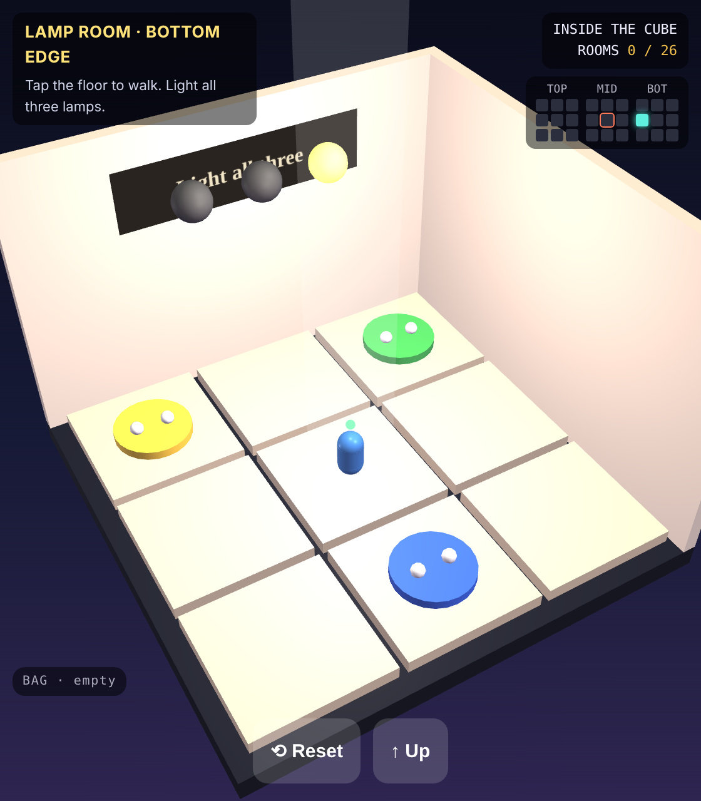
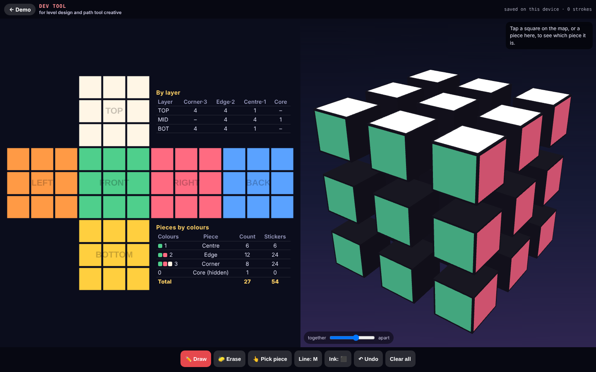

# Magic Cube — 27 Rooms

> 🚧 **Work in progress.** Rough prototype for team discussion — rules, rooms and ending are all still open.

| | Link |
|---|---|
| 🎮 **Play the demo** | https://yche1364-yj.github.io/MagicCube/ |
| 🛠 **Dev tool** (team only, password) | https://yche1364-yj.github.io/MagicCube/dev/ |
| 📄 Design doc (EN) | https://claude.ai/artifact/75xEzGdAY1R79nwgBR6trb |

Based on Koki's Unity prototype: https://kkoki0808.github.io/MagicCubePrototype_Koki-Demo/


---

## Concept

The world is a **scrambled Rubik's cube**. Every square carries a raised black path.
A little traveller walks along those paths — but the paths only connect when the cube is turned the right way.

A Rubik's cube is made of **27 pieces**: 26 on the outside and 1 hidden core.
Each of the **26 outer pieces has one entrance** (a white pit). Step into a pit and you drop into a **3D puzzle room**.
Solve all 26 rooms to unlock the **core** in the very middle — the ending.

| Colours on a piece | Piece | Count |
|---|---|---|
| 1 | Centre | 6 |
| 2 | Edge | 12 |
| 3 | Corner | 8 |
| 0 | Core (hidden) | 1 |
| | **Total** | **27** |

## How to play

**Two modes** (switch at the bottom):

- 🧩 **Puzzle mode** — rearrange the cube
  - **Swipe** across the cube → turn a row
  - **Tap** a square → spin that square
  - **↶** undo · **◀ ▶** rotate the view
- 🚶 **Explore mode** — walk the paths
  - **Tap** a square or use the **arrow keys** to walk
  - Paths can wrap around the cube's edges

**Rooms**

1. Walk onto a white pit → a **▶ 3D Puzzle** button appears.
2. Inside the room, solve the puzzle. Press **↑ Up** anytime to go back to where you came in.
3. A solved pit turns into a **gold square**, and the TOP / MID / BOT minimap (top right) lights up.
4. Items you collect go into the **bag** (bottom left). In a room that needs one, tap the item to use it.

**Room types**

- **Give / need pairs (10 pairs)** — one room gives an item, another room needs it:
  - Clock → Sudoku (a number 1–4)
  - Lamps → Gem door (red / blue / green gem)
  - One-stroke drawing → Shape pedestal (star / triangle / heart)
- **Stand-alone rooms (6)** — solve it and get a reward:
  - One-stroke → ✏️ **Path pen** (redraw a square's path)
  - Lamps → 🧭 **Guiding light** (shows where to go)

| Clock | Sudoku | Lamps | Gem door | One-stroke | Pedestal |
|---|---|---|---|---|---|
|  |  |  |  |  |  |

**Tutorial (first rooms)**

A glowing square shows where to go first: a nearly finished 4×4 sudoku that is **missing one number**.
You can't finish it → a gold beam leads you to a **clock** room, where one number is different → take it → go back and finish the sudoku.

**Faces** — when all nine squares of one face line up, that face's paths glow.

**Ending** — when all 26 rooms are solved, an **Enter the Core** button appears. *(The ending itself is still being designed.)*

## Dev tool

A page for the team to **design paths by hand**: draw freely on the unfolded six-face map, and the drawing shows up live on the 27 pieces in 3D.
Tools: Draw · Erase · Pick piece · line size · ink colour · Undo · Clear all.



- Protected by a simple password (ask the team). It only keeps casual visitors out — it is **not** real security, since this is a static site.
- On GitHub Pages, drawings are saved **on your own device only**. The claude.ai version of the Dev tool shares drawings with the team.

## Open questions

- What the solved cube looks like (gift box vs. one big loop — see `docs/images/`)
- Whether the cube restores itself after all 26 rooms, or per layer
- Story / narrative
- Ending inside the core

## Project structure

```
index.html        Game demo (single file, three.js r128 from CDN)
dev/index.html    Dev tool (path designer)
docs/images/      Screenshots used in this README
prototypes/       Earlier experiments (2D squares, 9 cubes, illusion rooms, …)
```

No build step — open `index.html` in a browser, or use GitHub Pages.

### Turn on GitHub Pages (one time)

Settings → Pages → Source: **Deploy from a branch** → Branch: `main` / `(root)` → Save.
