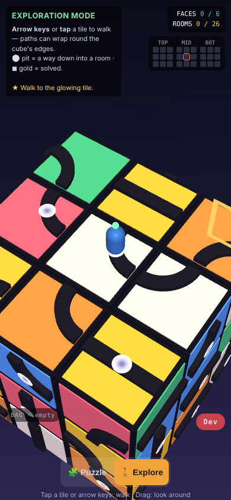
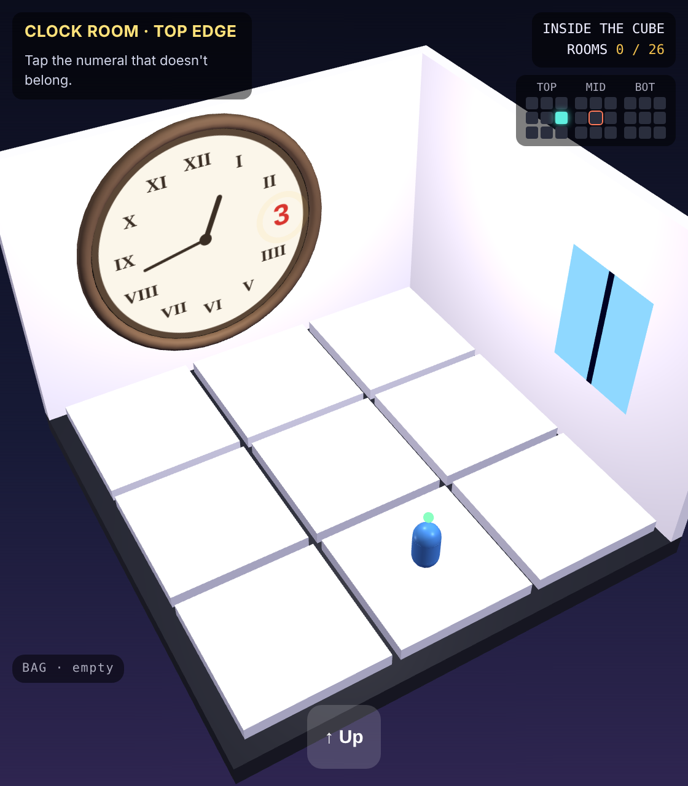
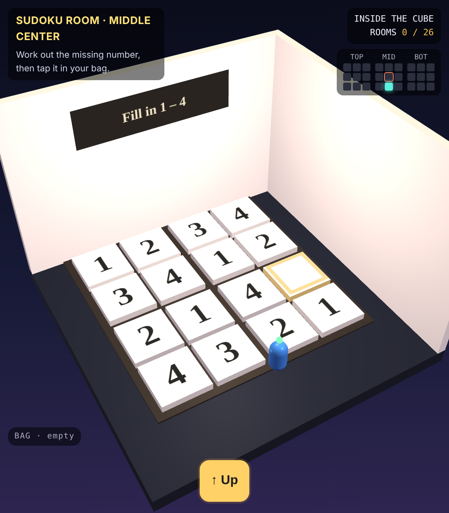
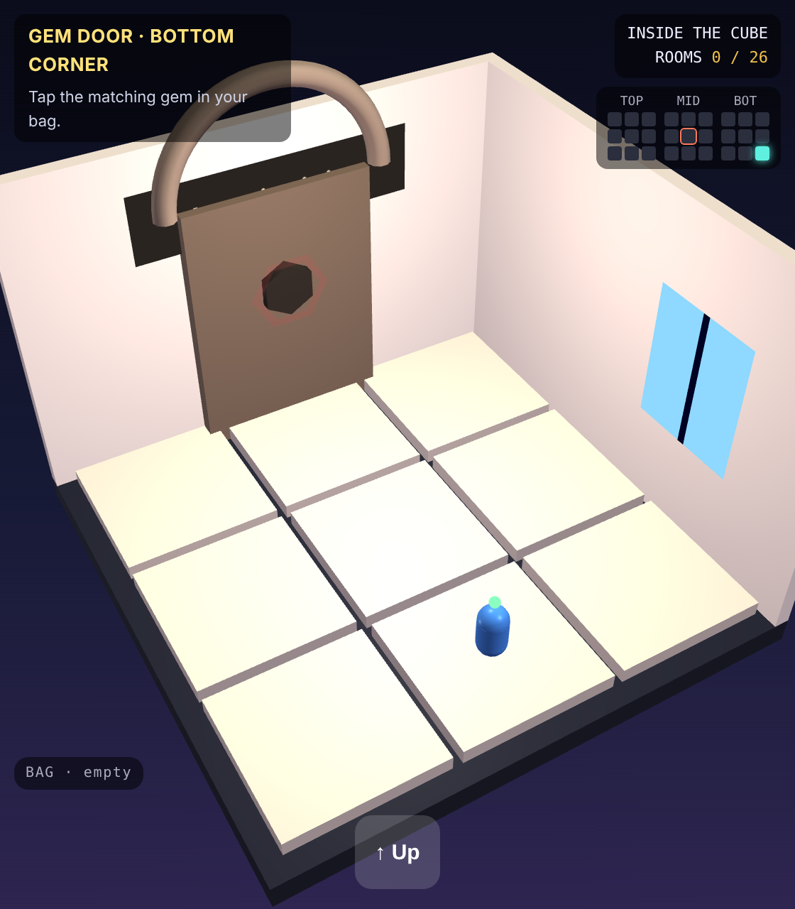
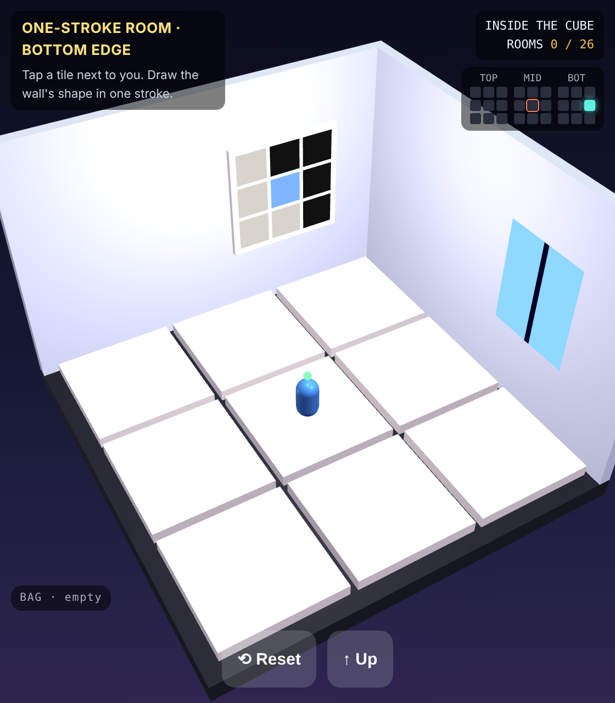
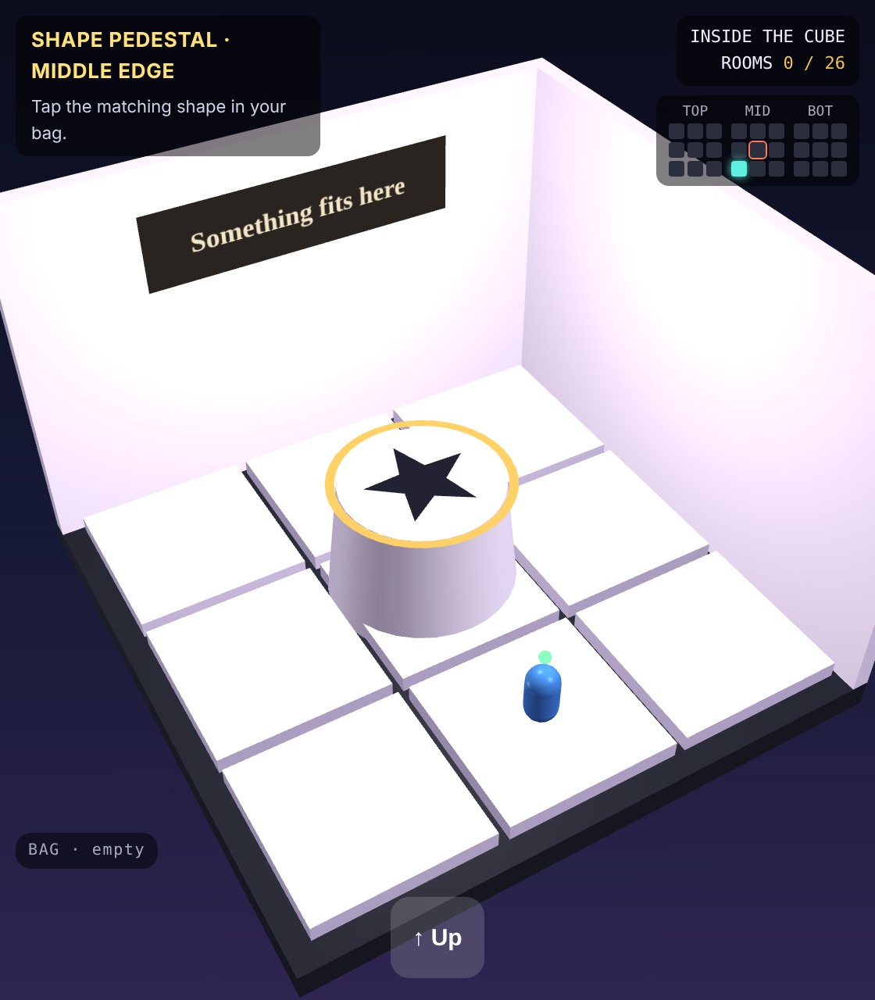

# Magic Cube — 54 Entrances

> 🚧 **Work in progress.** Rough prototype for team discussion — rules, rooms and ending are all still open.

| | Link |
|---|---|
| 🎮 **Play the demo** | https://yche1364-yj.github.io/MagicCube/ |
| 🛠 **Dev tool** (team only, password) | https://yche1364-yj.github.io/MagicCube/dev/ |
| 📄 Design doc (EN) | https://claude.ai/artifact/75xEzGdAY1R79nwgBR6trb |

Based on Koki's Unity prototype: https://kkoki0808.github.io/MagicCubePrototype_Koki-Demo/



---

## Concept

The world is a **scrambled Rubik's cube**. Every square carries a raised black path.
A little traveller walks along those paths — but the paths only connect when the cube is turned the right way.

A 3×3 Rubik's cube has **54 coloured facelets**: nine of each colour. In this design, every facelet is a possible entrance rather than every physical cubie owning one room. Edge and corner cubies can therefore carry two or three independent entrances.

Step into a facelet entrance to enter its puzzle space. White entrances contain progressive 6×6 Sudoku levels. Blue entrances contain sky and water alignment puzzles that provide numbers or number fragments required by the white rooms. The other colour families remain open for the rest of the team to define.

## How to play

**Two modes** (switch at the bottom):

- 🧩 **Puzzle mode** — rearrange the cube
  - **Swipe** across the cube → turn a row
  - **Tap** a square → spin that square
  - **↶** undo · **◀ ▶** rotate the view
- 🚶 **Explore mode** — walk the paths
  - **Tap** a square or use the **arrow keys** to walk
  - Paths can wrap around the cube's edges

**Rooms**

1. Walk onto a white pit → a **▶ 3D Puzzle** button appears.
2. Inside the room, solve the puzzle. Press **↑ Up** anytime to go back to where you came in.
3. A solved entrance turns into a **gold square**. Visited white entrances retain a symbol showing their current requirement, even after the cube moves.
4. Items you collect go into the **bag** (bottom left). In a room that needs one, tap the item to use it.

**White-and-blue first pass**

- Enter any unvisited white facelet to assign the next Sudoku difficulty.
- Restore puzzle-specific numbers found in blue rooms or along the outer maze.
- Complete a 6×6 Sudoku using numbers 1–6 and 2×3 regions.
- The solved Sudoku becomes a 3D floor. Cross it in consecutive two-step pairs totalling seven.
- Reaching the door completes the white entrance; its future door reward is intentionally still open.
- The first blue alignment teaches the mechanic by revealing a complete number.
- Later sky and water alignments reveal matching top and bottom fragments that combine into a number.

**Legacy prototype room types**

- **Give / need pairs (10 pairs)** — one room gives an item, another room needs it:
  - Clock → Sudoku (a number 1–4)
  - Lamps → Gem door (red / blue / green gem)
  - One-stroke drawing → Shape pedestal (star / triangle / heart)
- **Stand-alone rooms (6)** — solve it and get a reward:
  - One-stroke → ✏️ **Path pen** (redraw a square's path)
  - Lamps → 🧭 **Guiding light** (shows where to go)

| Clock | Sudoku | Lamps | Gem door | One-stroke | Pedestal |
|---|---|---|---|---|---|
|  |  |  |  |  |  |

**Tutorial (first rooms)**

A glowing square shows the first white entrance: a 6×6 Sudoku with one externally locked number.
You cannot finish it → a marked blue entrance teaches the forced-perspective alignment mechanic → collect the number → return to the marked white entrance → complete the Sudoku → cross its sum-seven floor → reach the door.

**Faces** — when all nine squares of one face line up, that face's paths glow.

**Ending** — the complete 54-entrance ending and central reward structure are still being designed.

## Dev tool

A page for the team to **design paths by hand**: draw freely on the unfolded six-face map, and the drawing shows up live on the 27 pieces in 3D.
Tools: Draw · Erase · Pick piece · line size · ink colour · Undo · Clear all.


- Protected by a simple password (ask the team). It only keeps casual visitors out — it is **not** real security, since this is a static site.
- On GitHub Pages, drawings are saved **on your own device only**. The claude.ai version of the Dev tool shares drawings with the team.

## Open questions

- What the solved cube looks like (gift box vs. one big loop — see `docs/images/`)
- Whether the cube restores itself after all 54 entrances, per colour, or per layer
- Story / narrative
- Ending inside the core

## Project structure

```
index.html        Game demo (single file, three.js r128 from CDN)
scripts/          Deterministic puzzle and route validation
dev/index.html    Dev tool (path designer)
docs/images/      Screenshots used in this README
prototypes/       Earlier experiments (2D squares, 9 cubes, illusion rooms, …)
```

No build step — open `index.html` in a browser, or use GitHub Pages.

### Turn on GitHub Pages (one time)

Settings → Pages → Source: **Deploy from a branch** → Branch: `main` / `(root)` → Save.
